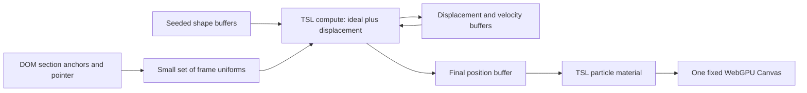

# R3F v10 — a particle release page

Discussion draft · 9 September 2026 · Audit and implementation proposal

## Recommended direction

Build a Next.js page with ordinary, statically rendered content and one persistent WebGPU Canvas. Use the Poimandres mark as the opening particle sculpture, a torus knot in the middle, and a faceted sphere near the close. Between sculptures, the same particles disperse into quiet streams along the reading margins.

The defining behavior is **a moving ideal position plus a temporary interaction displacement**. Scroll and time determine where each particle belongs. GPU compute remembers how the pointer displaced it. That separation lets particles return to the position they would have occupied without interaction, even while the page continues scrolling.

Keep three reusable motion modes: sculpture, transition, and margin flow. Shapes are inputs to these modes. The first implementation should prove the logo → margins → knot sequence before expanding the page.

This deliverable is a spec for discussion. No application has been scaffolded or deployed, and neither reference repository has been modified. Material in those repositories and on the reference page was treated as audit evidence, not as additional user requests.

## What the audit established

### Astra reference

Inspected the [live reference](https://openai.com/index/gpt-6-astra/) in Chrome at approximately 1167 × 798 CSS pixels, including the hero, reading sections, middle sculpture region, and closing sculpture region.

- The main document contained one canvas inside a fixed, viewport-filling wrapper. The wrapper has pointer events disabled; separate DOM interaction regions advertise rotation controls.
- The hero uses a luminous spiral formation on a nearly black, subtly blue background. Particle brightness and size vary markedly, with sparse warm accents among cooler lights.
- Reading sections have a dark, quiet center and scattered particles at the sides. Wide content panels have their own opaque backgrounds. Readability is partly composition and partly DOM layering.
- Three DOM interaction regions identify the star-field hero, a cursor sculpture, and an OpenAI blossom. Thus there are more shape moments than just the opening and ending. A reusable shape mode explains the structure well.
- Dedicated tall gaps give sculptures and transitions space between content passages.

The fixed canvas and interaction regions are DOM observations. Screenshots establish composition and appearance. The exact particle count, shader algorithms, force model, transition curves, and individual particle correspondence were **not** reverse engineered. The pointer restoration and stagger described in the request are requirements for our implementation, not independently proven internals of Astra. Drag rotation is visible in its control labels; it is optional for our first version.

### Local sources and versions

| Source | Finding | Implication |
| --- | --- | --- |
| This workspace | Initially empty | Start a focused app rather than modify either reference project |
| Workshop package and lockfile | Next 16.3.0; React 19.2.8; Fiber 10.0.0-alpha.5; Three 0.185.1; Three types 0.185.4; Drei 11.0.0-alpha.7 | Useful reproducible baseline, not a claim these are the latest releases |
| Fiber current checkout | `fix-stencil`, commit `55c6100826aa022ad9e57180d3de504f5419195a`, package declares alpha.4 | Do not silently link the current checkout as if it were v10 head |
| Locally available `v10` and `origin/v10` refs | Both `27df622f4990778db05fbca0b77ad5a61165169a`, package declares alpha.5 | Read these refs without switching branches; this is the content snapshot |
| v10 docs | WebGPU entry, resource hooks, compute storage, scheduler phases, render pipeline | Enough material for a concise technical narrative |

The remote-tracking ref is the locally available snapshot; no network fetch was performed to establish that it is the newest remote commit. The relevant compute, overview, migration and frame-loop documents match the current checkout; the TSL hooks document has a small difference that was checked with `git show v10:...`.

### Reuse selectively

Reuse the workshop's section/wrap concept, client-only experience boundary, capability/poster pattern, and [exact Poimandres mark](/Users/dex/Developer/workshop-fallback/src/components/brand/logo.tsx). Its compute cursor and persistent-particle examples are useful algorithm references.

Do not copy the whole workshop scaffold. Its multiple canvases, shared renderer coordination, Rapier patch, environment assets, and teaching controls solve other problems. Our page needs one renderer, one particle population, and a small set of inputs.

There are concrete reasons to adapt the examples:

- The persistent-particle example registers buffers with `useGPUStorage`; the v10 compute docs explicitly assign buffer ownership to `useBuffers` and storage textures to `useGPUStorage`.
- That example casts the renderer because of an older typing limitation. The installed alpha.5 WebGPU declarations already narrow `useFrame` and `useThree` to `WebGPURenderer`.
- Its frame callback does not explicitly select a phase. Our compute pass will run in `update`, before rendering.
- Its comment says compute has no WebGL fallback. Installed Three 0.185.1 actually contains a transform-feedback compute path in `WebGLBackend`. We will require a real WebGPU backend as a product choice for this showcase, rather than repeat a blanket technical claim. WebGL feature parity is outside this first version.

## Page and visual direction

Working title: **React Three Fiber / 10**. Supporting line: **A new shape for React on the GPU.** Mark v10 as an alpha preview in the intro and link to the migration material. Avoid announcing it as a stable release.

Use a near-black blue background, warm white typography, cool silver particles, and restrained peach highlights. Most particles should be small and relatively dim; a minority provide larger glints. Keep the logo readable without turning it into a uniformly glowing solid. Avoid heavy full-screen bloom that washes out its negative spaces.

Use a narrow reading column around 640–720 px and wider code/features sections up to roughly 1120 px. These are initial layout targets, adjusted for the actual font and viewport. Keep text in the DOM. Let sculptures have their own tall visual regions, with text above, below, or beside their focal area.

| Beat | Content | Particle behavior | Starting space budget |
| --- | --- | --- | --- |
| Opening | “React Three Fiber / 10” and short invitation | Shallow, dimensional Poimandres mark; restrained streaming along its structure; pointer pushes particles aside | 110–130 svh |
| Release | “React, meet the GPU” | Mark loosens quickly, then clears into the margins | 50–70 svh transition, then natural content |
| Nodes | “Compose materials in TypeScript” | Slow margin streams around prose and one short TSL example | Natural content height |
| Compute reveal | “The GPU remembers” | Streams gather into a torus knot; displaced particles retain their recovery motion while assembling | 120–160 svh including entry and exit |
| Scheduling | “A frame with an order” | Knot opens outward; particles return to the sides around a concise input → compute → render explanation | Natural content height plus 40–60 svh transition |
| Closing | “Build what comes next” with docs/source links | Faceted sphere gathers; a slight rotation reveals depth; no additional explosion at the CTA | 110–140 svh |

These heights are tunable budgets, not a requirement to pad short content artificially. Expect roughly 7–10 viewport heights overall. A small “How it works” disclosure can show the relevant real code and link to its source once implemented; it should not become a permanent dashboard over the art.

Content comes from the v10 migration, overview, TSL hooks, compute, and scheduler docs. Each section should make one claim and connect it to something visible on this page. Explain that TSL and compute belong to Three.js; Fiber v10 supplies React integration, ownership hooks, and scheduling. Do not imply v10 invented GPU computation or that a vertex-only effect inherently requires compute.

## Particle motion contract

### Stable identities and shape sampling

Allocate one fixed population for the selected quality tier. Every index gets deterministic seeds for size, color, phase, depth, transition delay, and cohort. A particle retains its identity across every section.

Sample the Poimandres SVG's actual filled regions and edges, preserving holes and gaps. Add a shallow extrusion and a small halo population. Start with about 70% area samples, 20% edge samples, and 10% loose companions; tune by silhouette readability. The logo is simple enough to derive from its source geometry without a heavy model asset.

Generate the torus knot and faceted sphere from procedural meshes. Use area-weighted triangle sampling, with a separate controlled edge contribution for the sphere. A small depth band provides volume without hiding the shape in a dense cloud. Validate the logo from the intended camera angle before adding elaborate flow.

All target sets have the same particle count. Assign correspondences once using coarse spatial bins or Morton ordering in a normalized canonical frame. Try the cheap assignment first; improve only if transitions visibly knot up. Independent random assignments for every shape are likely to create an indiscriminate crossing cloud. Uniformly dispersed seeds ensure a lower-count tier still covers the entire shape.

### Ideal position

For particle `i`, scroll `s`, and animation time `t`:

```text
u_i = smoothstep(delay_i, delay_i + duration_i, transitionProgress(s))
ideal_i(s,t) = mix(targetA_i(t), targetB_i(t), u_i)
             + transitionArc_i(u_i)
```

The transition arc vanishes at both endpoints. An envelope such as `16 * u² * (1-u)²` also has zero endpoint slope, making it a better starting point than a hard burst. During dispersal, arc directions favor outward movement and the assigned margin, with some depth variation.

For a settled sculpture, the target is a sampled shape point plus subtle, bounded motion. Flow should follow a known loop or tangent path parameterized by that particle's phase. Do not repeatedly integrate a noisy field into the ideal position: it would drift and lose correspondence. In the logo, long-lived silhouette structure matters more than unrestricted circulation.

Margin targets are smoothly looping ribbons with an exclusion region derived from the content width. Use bounded periodic paths rather than visible modulo wrapping. Wider panels push ribbons farther out. When there is insufficient room, reduce particle opacity and density near the content instead of forcing streams through text.

### Mouse displacement: why compute matters

Store a displacement `d_i` and displacement velocity `v_i` on the GPU:

```text
visible_i = ideal_i + d_i
dv_i/dt  = pointerForce(visible_i, pointer) - k_i*d_i - c_i*v_i
dd_i/dt  = v_i
```

Use near-critical damping initially (`c_i ≈ 2*sqrt(k_i)` with unit mass), then art-direct the range. With no input, `d_i` and `v_i` decay to zero while `ideal_i` keeps moving. This directly satisfies “where it would have been had the mouse not moved.” Springing the full position toward a changing target would add tracking lag to the authored choreography.

Compute evaluates the ideal, advances the displacement, and writes the final position buffer. The render material reads that buffer directly. There is no per-frame CPU particle loop or production GPU readback.

Measure pointer influence in camera/view space. Keep the radius stable in CSS pixels, then account for depth when converting displacement. Use a softened radial falloff, safe normalization at zero distance, capped force, and a small contribution from pointer velocity. Preserve a separate active flag so the initial `(0,0)` pointer value does not disturb the hero before an event.

Capture passive pointer events on the page wrapper and map client coordinates relative to the Canvas bounds. The canvas itself can keep `pointer-events: none`, allowing native text selection, links and scrolling. Disable influence over interactive controls and fade it on pointer leave, blur, or touch scrolling. Do not raycast every particle.

Start with a fixed-step displacement integrator at 1/120 s, capped at four steps per rendered frame. Implement the bounded substeps inside one compute dispatch where practical; use capped accumulated time and reset the accumulator after a hidden tab resumes. Evaluate the authored target from the current scroll/time so dropping simulation backlog cannot strand a particle in an obsolete section. These numbers are tuning defaults, subject to the prototype.

### Scroll stagger and depth

Use native document scrolling. Do not replace it with a virtual scroll system for the first version. Measure named section anchors after fonts/layout settle and update their cached bounds on resize or content changes. Read scroll into refs and transfer a handful of uniforms in the scheduler's input phase.

Separate three effects:

- **Stagger:** deterministic per-particle delay and transition duration. Most particles clear early; fewer trail behind. Every intended arrival finishes before the next hold.
- **Parallax:** stable depth groups produce different screen displacement as scroll changes, including a small almost stationary background cohort.
- **Interaction:** displacement follows its own time-based recovery, independent of scroll position.

Represent the choreography as intervals with an outgoing pose, incoming pose, clear-width target, and transition profile. Avoid equal divisions of total document height, which break when copy changes. Scrubbing backward must retrace the same ideal targets; inertia in the mouse displacement may remain, as intended. Direct anchor jumps and restored scroll positions evaluate the correct interval immediately rather than replaying every skipped transition.

## GPU and React design



Use `three/webgpu`, `three/tsl`, and `@react-three/fiber/webgpu` consistently. The provisional dependency baseline is the workshop's exact Fiber/Three/React versions above. Use the corresponding Next baseline for the compatibility spike, then check an appropriate patch update before publication. Avoid caret ranges for the core graphics stack. Drei is optional; add it only for a helper this scene actually needs.

| API | Concrete role |
| --- | --- |
| `useBuffers` | Own shape targets, displacement, velocity and final positions in a named particle scope |
| `useNodes` | Own reusable target/force TSL functions and a stable compute graph |
| `useLocalNodes` | Compose the particle material's position, color, opacity and size nodes |
| `useUniforms` | React-owned art settings such as palette and pointer strength |
| `uniform()` inside a stable graph owner | Frame-owned scroll, pointer, timestep and optional controlled debug time; do not reset them during React renders |
| `useFrame` with `phase: 'input'` | Update frame inputs without React state changes |
| `useFrame` with `phase: 'update'` | Initialize idempotently when ready, then dispatch `renderer.compute(update)` |
| `useRenderPipeline` | Optional restrained bloom after the base material already looks right |

Build compute kernels as `Fn(() => { ... })().compute(count)`. Read and write only the current particle's mutable slots. This independent update can operate in place; it does not require a neighbor grid, atomics or ping-pong simulation buffers. A later interaction that reads neighbors would require reconsidering that choice.

Prefer a stable builder function; an inline creator whose identity changes can rebuild `useLocalNodes` graphs. Keep resource handles stable and expose mutable scalar inputs through uniforms. Buffer resize is structural work: select the population tier at startup, and use DPR/bloom adjustments for runtime adaptation. Verify ownership and disposal on actual unmount and Strict Mode replay; “registered in a store” alone is not proof GPU memory was released.

Do not register an extra `render` phase callback just to dispatch compute. In v10, registering there takes over default rendering. Use normal Fiber rendering until a deliberately owned render pipeline is needed.

### Rendering and particle style

Use an instanced Sprite with `PointsNodeMaterial`, or an explicitly instanced billboard quad if that offers better control in the pinned Three version. Variable-size particles cannot rely on native WebGPU point primitives, which are limited to one pixel. See the [Three.js material documentation](https://threejs.org/docs/pages/PointsNodeMaterial.html).

Create the appearance with TSL: a soft circular center, subtle elongated/diamond variants, depth fade, seeded color temperature, restrained time-based brightness and a sparse larger-glint cohort. Begin with one batch and additive blending over the dark scene, with depth writes disabled. Inspect accumulated brightness before adding bloom. Use `frustumCulled={false}` when GPU positions invalidate CPU bounds.

The 3D layer should stay behind the content. Use both geometric clearance and a soft screen-space opacity exclusion region around reading areas, plus opaque surfaces for wide code panels. Apply clearance early enough that lagging particles cannot obscure incoming headings.

### App structure

```text
src/app/page.tsx                    Static page composition and metadata
src/app/globals.css                 Typography, sections and layer ordering
src/components/story-section.tsx    Semantic section and visual-space variants
src/content/story.ts                Copy and stable section identifiers
src/experience/index.tsx            Client component with dynamic ssr:false boundary
src/experience/particle-field.tsx   Canvas, capability state and scene ownership
src/experience/particles.tsx        Buffer and material ownership, frame jobs
src/experience/nodes/targets.ts     Shape and margin target expressions
src/experience/nodes/simulate.ts    Pointer displacement compute graph
src/experience/nodes/appearance.ts  TSL particle appearance
src/experience/shape-data.ts        Seeded CPU sampling, performed once
src/experience/choreography.ts     Named intervals and tuning values
src/experience/use-story-input.ts  DOM measurements, pointer and scroll refs
```

These are proposed boundaries, not a mandate to split trivial functions into files. Keep the scene independent of Next routing so it could move to Vite later. Next contributes pre-rendered content, metadata, fonts and a familiar shell; Vite would simplify framework setup but would not make GPU particle work inherently faster.

The no-SSR dynamic import must live inside a Client Component; marking a module `'use client'` by itself does not guarantee it will never be prerendered. This matches the [Next lazy-loading guidance](https://nextjs.org/docs/app/guides/lazy-loading) and the installed workshop documentation.

## Performance and fallback

Start at 24,576 particles for desktop, 12,288 for a constrained tier, and 6,144 for a small mobile tier. Begin around DPR 1.5 desktop / 1 mobile, with bloom off during the initial motion work. These are proposed budgets, not benchmark results. For perspective, six vec4-sized buffers at the desktop count are about 2.25 MiB before geometry, seeds, render targets and driver overhead; fill rate and post-processing may cost more than particle storage.

Aim for 60 fps on the agreed desktop test device and at least 30 fps on the selected mobile device. Record device, browser, viewport, DPR and particle tier with measurements. Reduce DPR, glint overdraw and bloom before resorting to dynamic buffer reallocation. Report CPU frame timings separately from GPU timings; wrapping `renderer.compute()` in a timer measures submission overhead, not completed GPU execution.

Serve content and a static logo/poster immediately. Check adapter availability, then renderer initialization and actual backend before revealing the canvas. If initialization fails or the device is lost, keep the DOM usable and return to the poster. Avoid an indefinite full-page loader.

For reduced motion, show static compositions, disable pointer disturbance and ongoing animation, and preserve all content. Provide a visible pause option for continuous animation. Touch scrolling remains native; there is no required hover interaction. A `?no3d` route flag gives a deterministic fallback QA path. Pause compute and rendering while the document is hidden; resume at the current scroll state without a large integration jump.

On narrow screens, place sculptures above the associated copy, reduce depth spread, and fade margin particles where there is no gutter. Font loading, orientation changes, and mobile browser chrome must not move scene anchors out of alignment.

## Build order and review points

1. **Compatibility and motion spike.** Install the pinned minimal stack, prove a real WebGPU compute dispatch, and render a small sampled logo with TSL. Add displacement/velocity buffers and pointer restoration. Review whether the logo reads and whether disturbed particles rejoin their moving targets. This is the first concrete review artifact.
2. **Continuous choreography.** Add margins and the knot, measured DOM anchors, per-particle stagger and parallax. Validate backward scrolling and direct jumps. Review the entire logo → margins → knot sequence with placeholder copy.
3. **Visual finish.** Tune sprite shape, brightness distribution, shape correspondence, transition arcs and text clearance. Add bloom only if it improves the result within budget. Review the look at desktop and phone sizes.
4. **Complete the page.** Add the sphere, concise v10 content, real code disclosure, docs/source links and all fallback states. Use the implementation to keep public explanations accurate.
5. **Production validation.** Type-check, lint and production-build. Exercise the production app in a real WebGPU browser, profile it, and capture representative stills plus a short scroll/pointer recording. Resolve failures before calling the demo complete.

No precise delivery estimate is justified before the spike: the main uncertainty is visual quality under movement, followed by alpha resource lifecycle and mobile fill rate.

## Acceptance criteria

- One canvas remains mounted through ordinary scrolling; changing sections does not regenerate the particle population.
- The hero clearly matches the workshop Poimandres mark, including its negative spaces.
- With frozen choreography in debug mode, releasing the pointer reduces a typical displacement to below 5% within roughly 1–1.5 seconds, without persistent oscillation. With choreography running, particles return to their current ideal locations, not an old shape position.
- Scroll transitions are continuous in both directions. Most particles clear the text region early; visible depth cohorts retain distinct rates. All intended sculpture particles arrive by the hold interval.
- Rapid scrolling, anchor navigation and restored scroll positions choose the correct shape without requiring previous sections to have run.
- Text, links, selection and touch scrolling remain usable. Wide panels retain clean backgrounds; headings are clear throughout transitions.
- No React re-render or CPU position-array upload is required per simulation frame. The published demo uses real WebGPU compute and TSL material nodes.
- No console errors, hydration warnings, blank interval during the handoff from poster, or accumulating resources across remount checks.
- Reduced-motion, `?no3d`, unavailable adapter, initialization failure and device-loss behavior preserve readable content.
- Check 1440×900, 1024×768 and 390×844 layouts. Confirm hardware/browser performance targets on named devices; do not infer success from headless rendering or a build alone.

Useful focused automated checks: continuity and endpoints of the scroll interval mapping; correct anchor selection on jumps; finite, in-bounds logo samples; accessible content in fallback. A small deterministic compute fixture can compare pointer-decay behavior against a CPU reference with tolerant floating-point thresholds. Full-resolution visual and input behavior still require browser verification.

## Decisions to discuss

The proposed defaults are Next.js, a dark luminous style, and logo → knot → sphere. The most consequential artistic choice is whether later sculptures should remain abstract geometry or become more literal symbols of the v10 features. Start abstract: the logo supplies identity, while the knot and sphere show surface sampling and volume clearly.

Keep orbit/drag rotation and a larger live tuning panel as later additions. Pointer repulsion and scroll choreography already supply the interaction needed to prove this concept. The central review should be the motion itself before investing in more content or controls.

## Local audit references

- [Workshop versions](/Users/dex/Developer/workshop-fallback/package.json) and [resolved dependencies](/Users/dex/Developer/workshop-fallback/pnpm-lock.yaml).
- [Workshop section shell](/Users/dex/Developer/workshop-fallback/src/app/home/components/section.tsx), [capability gate](/Users/dex/Developer/workshop-fallback/src/lib/use-webgpu.ts), and [client-only compute boundaries](/Users/dex/Developer/workshop-fallback/src/app/experiences/compute/index.ts).
- [Persistent compute example](/Users/dex/Developer/workshop-fallback/src/app/experiences/compute/persist.tsx) and [cursor compute example](/Users/dex/Developer/workshop-fallback/src/app/experiences/compute/cursor.tsx).
- [Fiber migration](/Users/dex/Developer/react-three-fiber/docs/migration/v10.mdx), [TSL hooks](/Users/dex/Developer/react-three-fiber/docs/webgpu/tsl-hooks.mdx), [compute](/Users/dex/Developer/react-three-fiber/docs/webgpu/compute.mdx), and [scheduler](/Users/dex/Developer/react-three-fiber/docs/frame-loop.mdx). These file links show the checkout; use the recorded `v10` commit above for the audited branch snapshot.
- [Installed alpha.5 declarations](/Users/dex/Developer/workshop-fallback/node_modules/@react-three/fiber/dist/webgpu/index.d.ts), [Three fallback compute implementation](/Users/dex/Developer/workshop-fallback/node_modules/three/src/renderers/webgl-fallback/WebGLBackend.js), and [installed Next lazy-loading guide](/Users/dex/Developer/workshop-fallback/node_modules/next/dist/docs/01-app/02-guides/lazy-loading.md).
